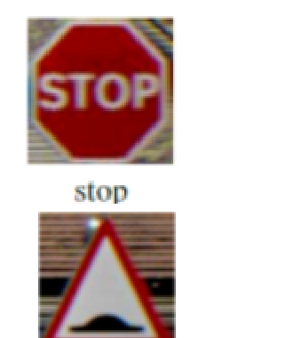
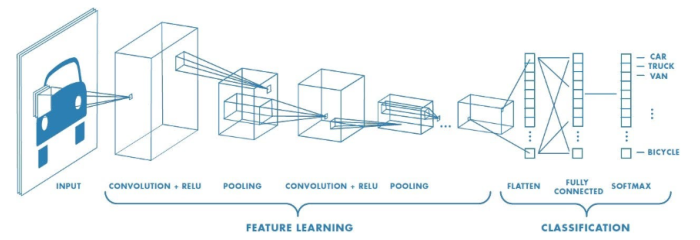
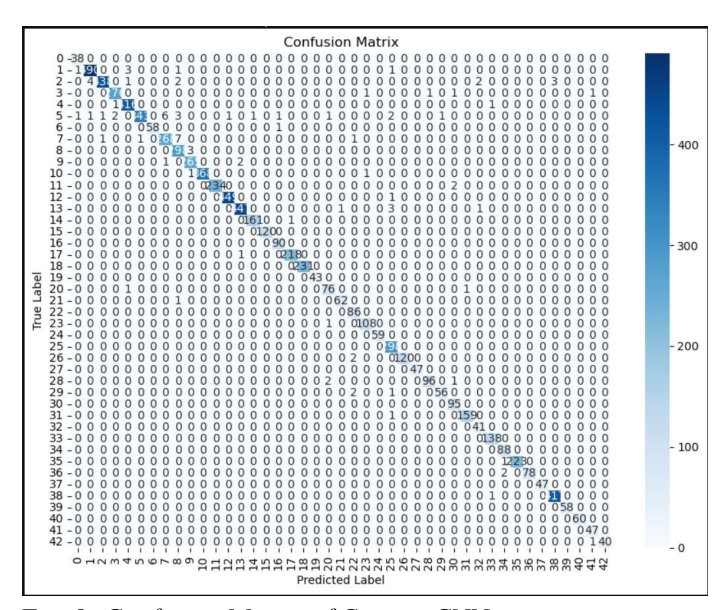
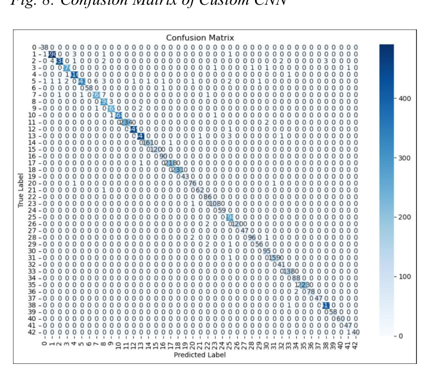
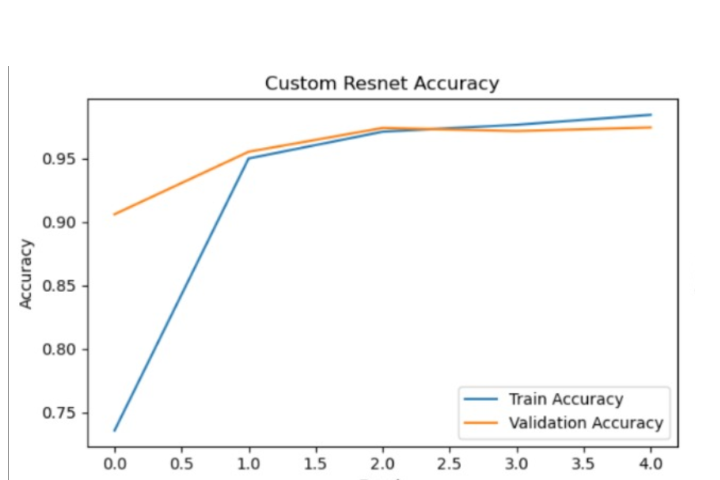
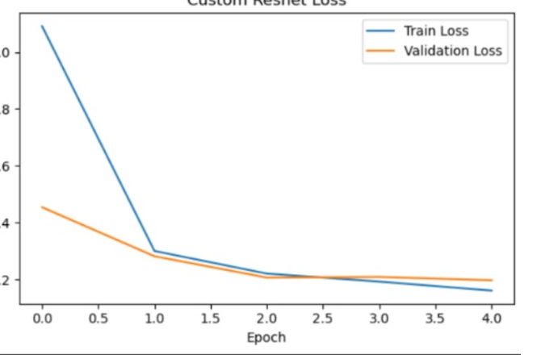

# 🚦 Traffic Sign Detection using CNN Models

Deep learning experiments for traffic sign recognition using convolutional neural networks and pretrained architectures. This project explores model development, training, evaluation, and prediction across multiple notebook versions.

## 🖼️ Project Figures

<table>
  <tr>
    <td align="center" width="50%">
      <br>
      <sub>Traffic sign classes</sub>
    </td>
    <td align="center" width="50%">
      <br>
      <sub>CNN architecture</sub>
    </td>
  </tr>
  <tr>
    <td align="center" width="50%">
      <br>
      <sub>Custom CNN confusion matrix</sub>
    </td>
    <td align="center" width="50%">
      <br>
      <sub>TinyResNet confusion matrix</sub>
    </td>
  </tr>
  <tr>
    <td align="center" width="50%">
      <br>
      <sub>TinyResNet accuracy</sub>
    </td>
    <td align="center" width="50%">
      <br>
      <sub>TinyResNet loss</sub>
    </td>
  </tr>
</table>

## 📄 Research Paper

### Traffic Sign Detection using CNN Models

[Read the Research Paper](./Traffic%20Sign%20Detection%20using%20CNN%20Models.PDF)

The accompanying paper explores traffic sign classification using CNN-based models and residual network architectures, using the German Traffic Sign Recognition Benchmark (GTSRB). It includes the methodology, experimental discussion, confusion matrices, training curves, and classification outputs.

The paper reports approximately **74% accuracy for the final ResNet model** described in its conclusion.

## 🧠 Project Overview

Traffic sign recognition is an important computer vision task for autonomous driving and driver-assistance systems. A reliable model must distinguish between multiple sign categories despite changes in lighting, image quality, viewing angle, and other challenging conditions.

This project explores different neural network architectures and experiments with their performance on traffic sign image classification.

### Main objectives

- Build a custom CNN for image classification.
- Experiment with residual and pretrained network architectures.
- Compare training and validation behaviour.
- Evaluate predictions using confusion matrices and classification metrics.
- Visualise model outputs on sample traffic sign images.
- Explore the balance between classification performance and computational requirements.

## 📚 Notebook Versions

The repository preserves the different notebook versions to make the progression of the experiments visible.

### Version 1 — Initial CNN and TinyResNet experiments

**File:** [`dlprojfinal.ipynb`](dlprojfinal.ipynb)

- Loads traffic sign images across 43 classes.
- Implements a custom CNN and a TinyResNet-style model.
- Trains and evaluates both approaches.
- Visualises accuracy and loss curves.
- Generates confusion matrices and sample predictions.

### Version 2 — Revised CNN and TinyResNet experiments

**File:** [`dlprojfinalV2.ipynb`](dlprojfinalV2.ipynb)

- Revises the initial notebook workflow.
- Experiments with CNN training settings and TinyResNet training.
- Includes training visualisations, evaluation, and prediction outputs.

### Version 3 — CNN and ResNet50

**File:** [`Final_V_3.ipynb`](Final_V_3.ipynb)

- Loads image data and labels from CSV files.
- Uses 64×64 image inputs.
- Implements a custom CNN and an ImageNet-pretrained ResNet50 with fine-tuning.
- Includes model evaluation, classification metrics, training plots, and image prediction functions.

### Version 4 — CNN and MobileNetV2

**File:** [`Final_V_4.ipynb`](Final_V_4.ipynb)

- Implements a custom CNN.
- Experiments with MobileNetV2 as the pretrained feature extractor.
- Includes training, validation, confusion matrices, classification reports, and sample predictions.
- Uses 64×64 image inputs.

### Version 5 — CNN and ResNet101

**File:** [`Final_v5.ipynb`](Final_v5.ipynb)

- Experiments with a custom CNN and pretrained ResNet101.
- Uses 224×224 image inputs for data loading and model construction.
- Includes training and evaluation workflows, classification reports, confusion matrices, and prediction visualisations.
- Explores fine-tuning a deeper pretrained architecture.

*These descriptions reflect the notebook code. The notebooks use different datasets and architectures, so their results should not be treated as a direct apples-to-apples comparison without aligning the experimental conditions.*

## 🗂️ Datasets

The notebooks reference two dataset workflows:

- **GTSRB:** German Traffic Sign Recognition Benchmark, containing 43 traffic sign classes.
- **CURE-TSD:** Used by the later notebooks for traffic sign detection/classification experiments.

The notebooks currently reference local dataset directories. Dataset files are not included in this repository by default; configure the paths and obtain the required data before running the experiments.

## 📊 Evaluation and Visualisation

The notebooks include several methods for examining model performance:

- Training and validation accuracy curves.
- Training and validation loss curves.
- Confusion matrices.
- Classification reports, including precision, recall, and F1-score where implemented.
- Predictions and visualisations for individual images.

The accompanying research paper discusses the reported results for its experiments. Results from the later notebook versions should be checked in their own outputs rather than assumed to match the paper.

## 🛠️ Tech Stack

- **Python**
- **TensorFlow / Keras**
- **NumPy and Pandas**
- **OpenCV and Pillow**
- **Matplotlib and Seaborn**
- **scikit-learn**
- **Jupyter Notebook**

## 🚀 Getting Started

### 1. Clone the repository

```bash
git clone https://github.com/Aditya-Nair-Git/Traffic-Sign-DL-Project.git
cd Traffic-Sign-DL-Project
```

### 2. Install dependencies

If a `requirements.txt` file is available:

```bash
pip install -r requirements.txt
```

Otherwise, install the libraries required by the notebook you intend to run. A starting point is:

```bash
pip install tensorflow numpy pandas matplotlib seaborn scikit-learn opencv-python pillow jupyter
```

### 3. Configure the dataset

Update the dataset paths in the selected notebook to point to your local GTSRB or CURE-TSD dataset directory. Make sure the directory structure and CSV files match the notebook's data-loading code.

### 4. Launch Jupyter Notebook

```bash
jupyter notebook
```

Open the desired notebook and run its cells in order.

**Note:** Training may require substantial time and memory depending on the model, image size, dataset, and available hardware.

## 📁 Repository Structure

```text
Traffic-Sign-DL-Project/
├── README.md
├── Traffic Sign Detection using CNN Models.PDF
├── assets/
│   ├── traffic-sign-classes.png
│   ├── cnn-architecture.png
│   ├── custom-cnn-confusion-matrix.png
│   ├── tinyresnet-confusion-matrix.png
│   ├── tinyresnet-accuracy.png
│   └── tinyresnet-loss.png
├── dlprojfinal.ipynb
├── dlprojfinalV2.ipynb
├── Final_V_3.ipynb
├── Final_V_4.ipynb
└── Final_v5.ipynb
```

## 🔭 Potential Future Improvements

- Standardise the datasets, preprocessing, and evaluation splits for fairer model comparisons.
- Investigate class imbalance and improve minority-class recognition.
- Compare model accuracy, inference time, and computational requirements under consistent conditions.
- Explore lightweight architectures for deployment on edge devices.
- Make dataset configuration portable instead of relying on machine-specific paths.

## 👤 Authors

- **Aditya Chandran Nair**

School of Computer Science and Engineering, VIT-AP University.

---

**Author profile:** [Aditya Nair on GitHub](https://github.com/Aditya-Nair-Git)

